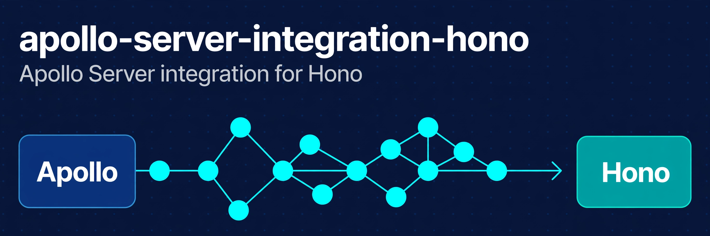

<p align="center">
  
</p>

<p align="center"><strong>Serve Apollo Server 5 from a Hono app, with streamed incremental delivery</strong></p>

<p align="center">
  <a href="https://www.npmjs.com/package/@conao3/apollo-server-integration-hono"></a>
  <a href="https://github.com/conao3/ts-apollo-server-integration-hono/actions/workflows/ci.yml"></a>
  <a href="https://github.com/conao3/ts-apollo-server-integration-hono/blob/master/LICENSE"></a>
  <a href="https://github.com/conao3/ts-apollo-server-integration-hono/stargazers"></a>
</p>

<p align="center">
  <a href="#install">Install</a> ·
  <a href="#usage">Usage</a> ·
  <a href="#context">Context</a> ·
  <a href="#development">Development</a> ·
  <a href="https://www.npmjs.com/package/@conao3/apollo-server-integration-hono">npm</a>
</p>

# @conao3/apollo-server-integration-hono

[Apollo Server](https://www.apollographql.com/docs/apollo-server) integration for [Hono](https://hono.dev).

It passes the whole `@apollo/server-integration-testsuite`, including incremental delivery (`@defer` / `@stream`), and streams `multipart/mixed` responses as Apollo Server produces them.

- One function, `startServerAndCreateHonoHandler`, turns an `ApolloServer` into a Hono handler.
- Your `context` function receives the Hono context `c`, typed with the `Env` of your app.
- Headers from Hono middleware, such as `hono/cors`, stay on the GraphQL response.
- The package uses Web standard APIs and depends on `@apollo/server` and `hono` alone.

## Install

```sh
pnpm add @conao3/apollo-server-integration-hono @apollo/server graphql hono
```

The package needs `@apollo/server` 5, `hono` 4 and Node.js 20 or later.

## Usage

```ts
import { ApolloServer } from "@apollo/server"
import { startServerAndCreateHonoHandler } from "@conao3/apollo-server-integration-hono"
import { serve } from "@hono/node-server"
import { Hono } from "hono"

const server = new ApolloServer({
  typeDefs: `#graphql
    type Query {
      hello: String!
    }
  `,
  resolvers: { Query: { hello: () => "world" } },
})

const app = new Hono()
app.on(["GET", "POST"], "/api/graphql", startServerAndCreateHonoHandler(server))

serve({ fetch: app.fetch, port: 4000 })
```

`startServerAndCreateHonoHandler` starts the server in the background, so call it once at startup and do not call `server.start()` yourself. It returns a Hono handler, which works on every runtime Hono supports.

A request with a JSON content type and a malformed body gets a `400` response.

### Context

The `context` function receives the Hono context as `c`. Give its argument the `Env` of your app to read variables set by middleware:

```ts
import type { HonoContextFunctionArgument } from "@conao3/apollo-server-integration-hono"

type AppEnv = { Variables: { user: string } }
type GraphQLContext = { user: string }

const app = new Hono<AppEnv>()
app.use(async (c, next) => {
  c.set("user", c.req.header("x-user") ?? "anonymous")
  await next()
})
app.post(
  "/api/graphql",
  startServerAndCreateHonoHandler(new ApolloServer<GraphQLContext>({ typeDefs, resolvers }), {
    context: async ({ c }: HonoContextFunctionArgument<AppEnv>) => ({ user: c.get("user") }),
  }),
)
```

Headers that middleware sets on the Hono context (for example `hono/cors`) stay on the GraphQL response.

## Development

```sh
nix develop          # Node.js 26, pnpm and a local Vite+ CLI wrapper
vp install           # installs dependencies and the pre-commit hook
vp run check         # format, lint, type check, unit tests and the Apollo Server integration test suite
vp pack              # builds dist/ and the example bundle
nix build .#build    # builds the package with Nix
nix run              # starts the example server at http://localhost:4000/api/graphql (PORT overrides the port)
```

Unit tests in `test/unit/` run on Vitest. The Apollo Server integration test suite in `test/integration/` runs on Jest, which the suite requires.

The suite skips its incremental delivery tests unless you set `INCREMENTAL_DELIVERY_TESTS_ENABLED`, and those tests need graphql 17. To run them, set `graphql: 17.0.0-alpha.9` in `overrides` of `pnpm-workspace.yaml` and run `INCREMENTAL_DELIVERY_TESTS_ENABLED=1 jest -t "modern incremental format|with defer modern"`.

When `pnpm-lock.yaml` changes, update `hash` in `flake.nix` (set it to `pkgs.lib.fakeHash`, run `nix build .#build`, and use the `got:` value).

## License

Apache-2.0
